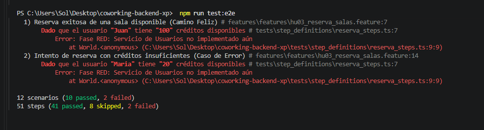
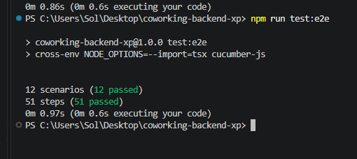

# Sistema de Gestión de Reservas de Coworking

Backend desarrollado con TypeScript, Express, XP y BDD. Incluye autenticación
JWT, autorización por roles, refresh tokens y controles de hardening.

## Tecnologías

- TypeScript con `strict: true`
- Express
- bcrypt
- JSON Web Tokens
- Cucumber + TSX
- CORS y rate limiting

## Instalación y ejecución

Requiere Node.js 18 o superior.

```powershell
npm install
npm run build
npm run test:e2e
npm start
```

El servidor queda disponible en `http://localhost:3000`.

Para desarrollo puede utilizarse:

```powershell
npm run dev
```

Copiar `.env.example` como `.env` y configurar un secreto JWT largo:

```text
NODE_ENV=development
PORT=3000
JWT_SECRET=replace-with-a-long-random-secret
CORS_ORIGIN=http://localhost:3000
```

## Seguridad implementada

### Autenticación

- `POST /api/registro`: valida los datos y almacena la contraseña con bcrypt.
- `POST /api/login`: verifica credenciales y devuelve un access token de 15
  minutos y un refresh token de 7 días.
- `POST /api/refresh`: rota el refresh token y emite un nuevo access token.
- `verificarToken`: valida `Authorization: Bearer <token>`, firma y expiración.

### Autorización

- `requerirRol`: implementa RBAC para `USER`, `EDITOR` y `ADMIN`.
- `requerirPropietario`: evita que un usuario modifique recursos de otro.
- `ADMIN` puede administrar recursos independientemente de su propietario.

### Hardening

- CORS restringido mediante `CORS_ORIGIN`.
- Rate limiting del login: cinco solicitudes por IP cada quince minutos.
- Validación de tipos, emails, contraseñas y contenido.
- El registro público siempre crea usuarios `USER`; no permite autoasignarse
  privilegios administrativos.
- En producción, `JWT_SECRET` es obligatorio.
- Los refresh tokens se almacenan como hashes y se rotan al utilizarse.

## Endpoints

| Método | Endpoint | Protección |
|---|---|---|
| `GET` | `/health` | Pública |
| `POST` | `/api/registro` | Pública |
| `POST` | `/api/login` | Pública + rate limit |
| `POST` | `/api/refresh` | Refresh token |
| `GET` | `/api/perfil` | JWT |
| `POST` | `/api/articulos` | `EDITOR` o `ADMIN` |
| `PUT` | `/api/articulos/:id` | Propietario o `ADMIN` |
| `DELETE` | `/api/usuarios/:id` | `ADMIN` |

Los artículos se almacenan en memoria e incluyen `autorId`. La persistencia se
reinicia al reiniciar el proceso; esto es intencional para el alcance de esta
actividad.

## Usuarios demo

En desarrollo se cargan automáticamente:

| Rol | Email | Contraseña |
|---|---|---|
| `ADMIN` | `admin@example.com` | `Admin123` |
| `EDITOR` | `editor@example.com` | `Editor123` |
| `USER` | `usuario@example.com` | `User123` |

## Evidencias de Postman

Las siguientes capturas documentan las pruebas HTTP solicitadas:

| # | Prueba | Resultado esperado | Evidencia |
|---|---|---|---|
| 1 | `GET /health` | `200 OK` | [COWORKING-GET](docs/seguridad/COWORKING-GET.png) |
| 2 | `POST /api/registro` | `201 Created` | [CrearUsuario](docs/seguridad/CrearUsuario.png) |
| 3 | `POST /api/login` válido | `200 OK` y JWT | [IniciarSesión](docs/seguridad/IniciarSesión.png) |
| 4 | `GET /api/perfil` con JWT | `200 OK` | [Perfil con JWT](docs/seguridad/ConsultarPerfilConJWT.png) |
| 5 | `GET /api/perfil` sin JWT | `401 Unauthorized` | [Perfil sin token](docs/seguridad/ConsultaPerfilSinToken.png) |
| 6 | Crear artículo como ADMIN | `201 Created` | [Crear como ADMIN](docs/seguridad/CrearComoAdmin.png) |
| 7 | Crear artículo como USER | `403 Forbidden` | [Crear como USER](docs/seguridad/CrearComoUSER.png) |
| 8 | Login con contraseña incorrecta | `401 Unauthorized` | [Login incorrecto](docs/seguridad/LoginIncorrecto.png) |
| 9 | Email duplicado | `409 Conflict` | [Email duplicado](docs/seguridad/EmailDuplicado.png) |
| 10 | Build y BDD | Exitosos | [Build y tests](docs/seguridad/Build-Test.png) |
| 11 | `POST /api/refresh` | Nuevo token | [Refresh token](docs/seguridad/RefreshToken.png) |
| 12 | Sexto login inválido | `429 Too Many Requests` | [Rate limiting](docs/seguridad/RateLimiting.png) |
| 13 | Usuario no propietario edita | `403 Forbidden` | [Prueba IDOR](docs/seguridad/EditarComoUSER(IDOR).png) |
| 14 | Access token expirado | `403 Forbidden` | [Token expirado](docs/seguridad/RefreshToken3.png) |

Pruebas complementarias:

- CORS con origen permitido: [CORS](docs/seguridad/CORS.png).
- Edición por propietario: [Artículo propio](docs/seguridad/CrearComoEditor(IDOR).png).
- Edición por administrador: [Eliminar como ADMIN](docs/seguridad/EliminarUsuarioComoADMIN.png).
- Contraseña corta: [Contraseña corta](docs/seguridad/ContraseñaCorta.png).
- Email inválido: [Email inválido](docs/seguridad/EmailInvalido.png).

## Evidencias XP y BDD





La suite actual contiene 12 escenarios y 51 pasos ejecutables:

```text
12 scenarios (12 passed)
51 steps (51 passed)
```

## Diseño

El proyecto utiliza capas `domain`, `repositories`, `services`, `controllers`,
`middlewares` y `routes`. El repositorio en memoria mantiene el alcance simple
para la actividad, mientras que los middlewares separan autenticación,
autorización por rol y autorización por propiedad.
